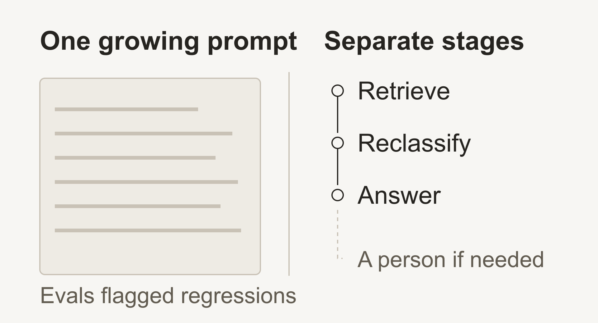
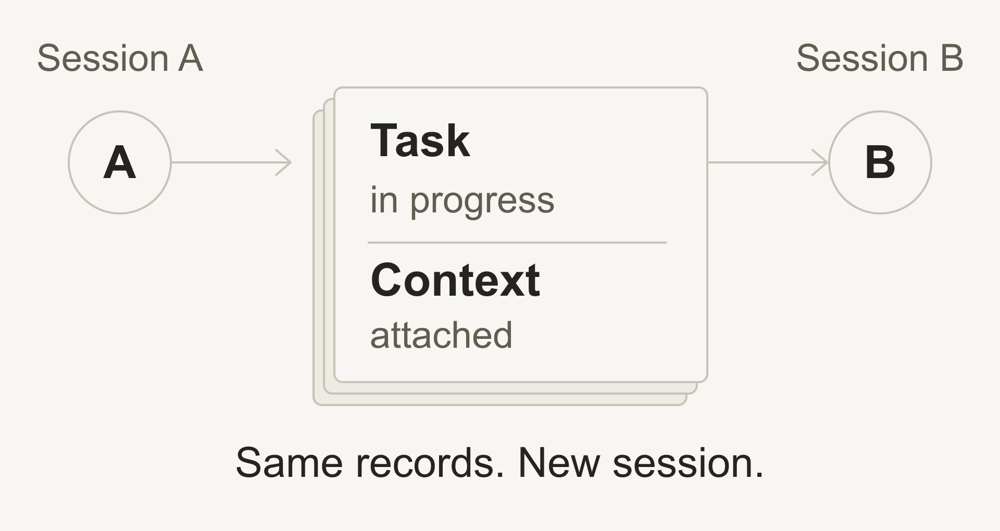
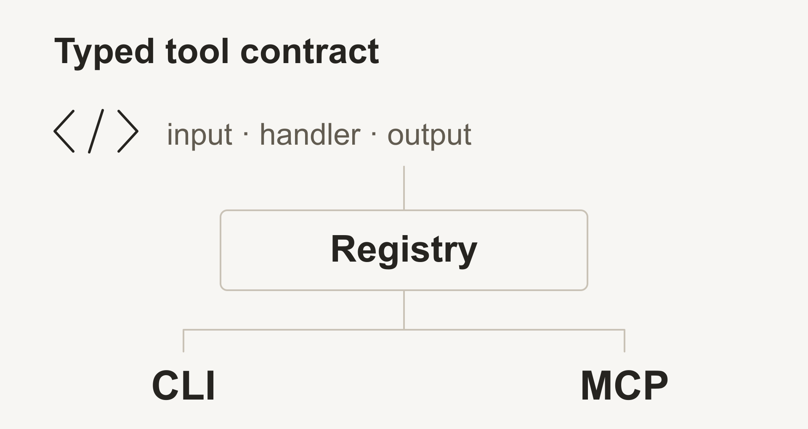
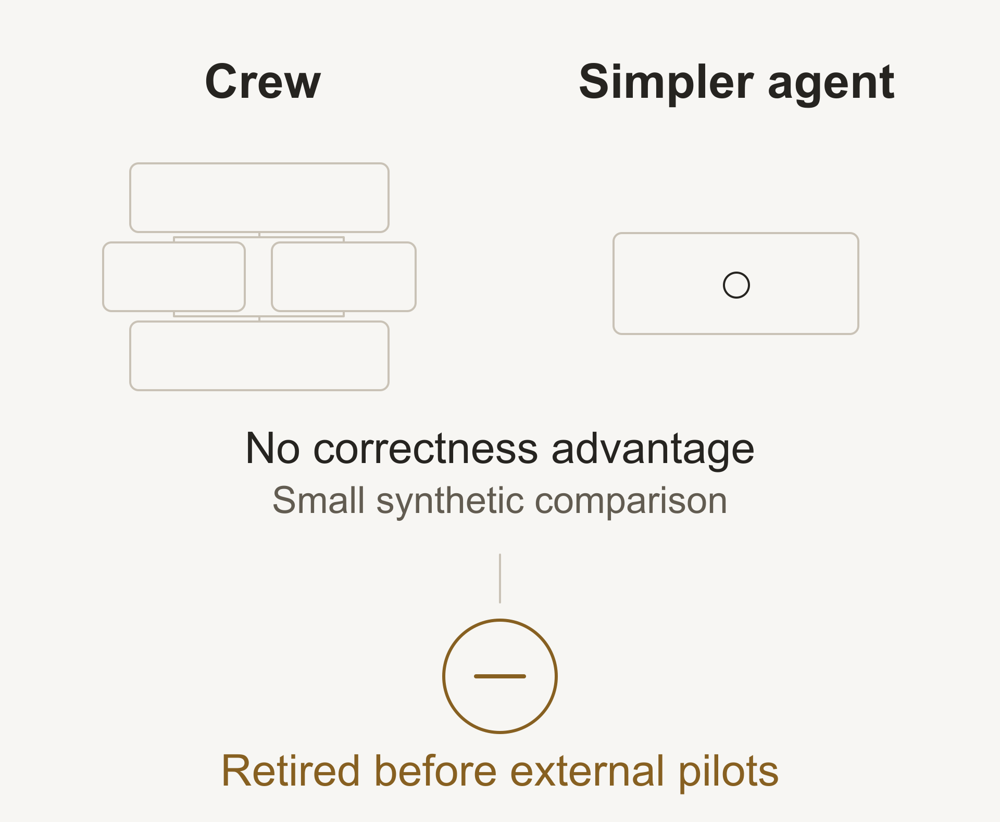

# ggofri

## Software shaped around the problem.

I work directly with customers to understand their problems and build software around them, from the first experiment to a product they can use.

**Product Engineering · AI Engineering · Applied AI · Forward Deployed Engineering · Growth Engineering**

### When a bigger prompt stopped helping.

**Mercado Libre · 2021–22 · Before ChatGPT**

The support bot's prompt kept growing. Evaluations showed its answers getting worse.

<picture>
  <source media="(prefers-color-scheme: dark)" srcset="assets/readme/mercado-libre-dark.png">
  
</picture>

I ran those evaluations, helped split the prompt into stages, and built model integration and backend orchestration, with human escalation.

### What does the system actually improve?

That question keeps coming back in my work.

- [**The Intervention Penalty**](https://doi.org/10.5281/zenodo.19457265): what does a human checkpoint cost? A simulation-based preprint. I wrote the initial draft; Sofia Plajutin edited.
- [**AI in Cybersecurity**](https://doi.org/10.5281/zenodo.19463970): what does a capability result actually establish? A coauthored evidence study. I contributed experiments, research and examples.

[Code, data and research materials →](https://github.com/bosun-sh/papers)

### Some questions become tools.

At **Bosun**, I explore related questions through tools people can inspect.

#### Keep the work when the session ends.

<picture>
  <source media="(prefers-color-scheme: dark)" srcset="assets/readme/logbook-dark.png">
  
</picture>

[**Logbook**](https://github.com/bosun-sh/logbook) keeps shared task state and context in readable JSONL records, with lifecycle hooks and Linear sync.

#### One tool contract. CLI and MCP.

<picture>
  <source media="(prefers-color-scheme: dark)" srcset="assets/readme/ohtools-dark.png">
  
</picture>

[**Ohtools**](https://github.com/bosun-sh/ohtools) lets agents inspect tool structure and declared schemas before calling a handler.

More at Bosun

[Chest](https://github.com/bosun-sh/chest) · [Plot](https://github.com/bosun-sh/plot) · [Sounder](https://github.com/bosun-sh/sounder) · [Skills](https://github.com/bosun-sh/skills)

## I also have a blog! See my latest posts
<!--START_SECTION:blog_posts-->
- [Your unfair advantage: show your work](https://ggofri.vercel.app/blog/unfair-advantage) - Aug 24 2025
- [Shiny object syndrome](https://ggofri.vercel.app/blog/shiny-object) - Jul 29 2025
- [It was always done this way](https://ggofri.vercel.app/blog/always-done-this-way) - Jul 29 2025
<!--END_SECTION:blog_posts-->

Recent activity

## :zap: Recent activity
<!--START_SECTION:activity-->
- ✨ Created repository or branch [bosun-sh/logbook](https://github.com/bosun-sh/logbook) - Oct 19
- ✨ Created repository or branch [bosun-sh/logbook](https://github.com/bosun-sh/logbook) - Oct 19
- 🚀 Pushed commits to [ggofri/vercel-skills](https://github.com/ggofri/vercel-skills) - Oct 19
- ✨ Created repository or branch [bosun-sh/chest](https://github.com/bosun-sh/chest) - Oct 19
- 🔄 Opened/updated PR in [vercel-labs/skills](https://github.com/vercel-labs/skills) - Oct 20
- 🔄 Opened/updated PR in [bosun-sh/chest](https://github.com/bosun-sh/chest) - Oct 19
- 🐛 Created/updated issue in [bosun-sh/chest](https://github.com/bosun-sh/chest) - Oct 19
- 🐛 Created/updated issue in [bosun-sh/chest](https://github.com/bosun-sh/chest) - Oct 19
- 🐛 Created/updated issue in [bosun-sh/chest](https://github.com/bosun-sh/chest) - Oct 19
- 🔄 Opened/updated PR in [bosun-sh/chest](https://github.com/bosun-sh/chest) - Oct 19
<!--END_SECTION:activity-->

 

---

## Four months of building. Then I chose to stop.

I built **Crew**, an AI development platform. Then I compared it with a simpler agent.

<picture>
  <source media="(prefers-color-scheme: dark)" srcset="assets/readme/crew-dark.png">
  
</picture>

The small synthetic comparison showed no automated correctness advantage, with higher recorded token use and median machine time. I stopped before an external pilot.

---

[**X**](https://x.com/ggofri) · [**LinkedIn**](https://linkedin.com/in/ggofri) · [**Email**](mailto:jiramirez@proton.me)

 

My grandma called me **Gofri**, and the family picked it up. She pronounced the G strongly, almost twice. So I write it twice.

Based in Buenos Aires. If you're nearby, let's compare notes over a mate. 🧉
